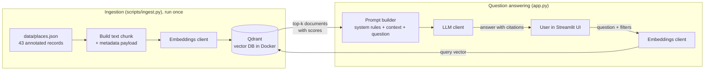

# 🏔️ Qazaq Guide: a RAG-based AI travel assistant for Kazakhstan

> **Demo video:** https://youtu.be/oF4PmKiHcvA
>
> Module 3 practical task "Development of RAG-based AI system", EPAM Gen AI for Software Development (Tech Orda).

## 1. Main idea

General-purpose LLMs know the famous sights of Kazakhstan only superficially. They often mix up regions and distances, invent prices, or miss practical details such as border permits, the right season or how to actually get to a canyon without public transport.

**Qazaq Guide** is a chat assistant that answers travel questions about Kazakhstan, such as *"Where can I go from Almaty for one day in summer to see a mountain lake?"*. Instead of relying on the model's memory, it first finds the most relevant entries in a **curated, annotated knowledge base** using **vector (semantic) search**, then asks the LLM to answer **only from those entries**, citing them as `[1]`, `[2]`.

Users can ask in **Russian, Kazakh or English**. Embeddings are multilingual, so a Russian question finds English documents, and the answer comes back in the language of the question.

## 2. Concepts used

| Concept | How it is used here |
|---|---|
| **RAG (Retrieval-Augmented Generation)** | The LLM receives the user's question together with documents retrieved from our own database, all in one context window. |
| **Embeddings** | Every document and every question is turned into a vector by an embedding model (`gemini-embedding-001`, 3072 dimensions, in the demo setup). Texts with similar meaning get vectors that are close to each other. |
| **Vector database** | Qdrant stores the vectors and metadata and finds the nearest vectors by **cosine similarity**. |
| **Metadata filtering** | Each vector has a payload (region, category, season, budget). The UI can combine semantic search with exact filters, e.g. "only winter", "only low budget". |
| **Grounding & citations** | The system prompt tells the model to use only the context, cite sources and say "no information" instead of hallucinating. |
| **Prompt engineering** | A role (travel assistant), explicit rules, output format and the language rule, as covered in Module 2. |

## 3. Architecture and design



**Request flow (step 7 of the task):**
1. The user types a question in the **Streamlit** chat (optionally chooses filters and top-k).
2. The question is converted to an **embedding vector** with the same model that was used for the documents.
3. **Qdrant** returns the `top_k` most similar documents (cosine similarity), with metadata filters applied.
4. The **original question and the found documents** are put into **one prompt** (numbered context + question), together with the last 4 chat turns for follow-up questions.
5. The **LLM** generates the answer; the UI shows it with an expandable list of sources and similarity scores. A debug toggle shows the exact prompt sent to the LLM.

### Project structure

```
qazaq-guide/
├── README.md               ← this document (project description)
├── docker-compose.yml      ← step 2: local Qdrant vector database
├── requirements.txt
├── .env.example            ← settings template (copy to .env, add your key)
├── data/places.json        ← step 1: the dataset
├── src/
│   ├── config.py           ← settings and provider selection (DIAL / OpenAI / Gemini)
│   ├── dataset.py          ← loading, validation, chunking, metadata
│   ├── embeddings_client.py← step 3: embeddings client
│   ├── vector_db.py        ← step 2/4: Qdrant collection, upload, vector search, filters
│   ├── llm_client.py       ← step 5: LLM client
│   └── rag.py              ← step 7: the RAG pipeline and prompt
├── scripts/
│   ├── ingest.py           ← step 4: fill the database
│   ├── check_embeddings.py ← step 3 demo: vectors + similarity
│   ├── check_llm.py        ← step 5 demo: plain request-response
│   └── search.py           ← step 4 demo: semantic search without the LLM
├── app.py                  ← step 6/7: Streamlit web UI
├── cli.py                  ← alternative command-line UI
└── tests/test_pipeline.py  ← offline tests (fake AI, in-memory Qdrant)
```

## 4. Dataset

**File:** `data/places.json`, **43 records** in English:

- **39 places**: nature (canyons, lakes, mountains, national parks), history (UNESCO sites, mausoleums, ancient cities), cities, sport and science (Baikonur);
- **4 practical guides**: visas and money, transport, Kazakh food and hospitality, safety in the mountains.

The dataset covers **all main parts of the country**: Almaty and the south-east, Zhetysu, the south (Turkistan, Shymkent, Taraz), the centre (Astana, Karaganda, Ulytau), the north (Burabay, Bayanaul), the west (Mangystau, Aral Sea, Baikonur) and the east (Altai).

**How it was made:** facts were collected from public sources (Wikipedia and official park information; each record links its main source) and written up with help from an LLM, then checked and edited manually. Prices are intentionally not given as numbers (only `low/medium/high`) because they change quickly.

**Annotation schema (every record):**

| Field | Type | Example | Purpose |
|---|---|---|---|
| `id` | string | `charyn-canyon` | unique, stable ID (used to make the DB point ID) |
| `name` | string | `Charyn Canyon` | title shown in sources |
| `doc_type` | `place` / `practical` | `place` | document kind |
| `region` | string | `Almaty Region` | **filter** |
| `nearest_city`, `distance_km` | string, int | `Almaty`, `200` | trip planning |
| `category` | string | `nature`, `history`, `city`, `lake`, `sport`, `science`, `practical`, `culture` | **filter** |
| `tags` | list | `["canyon","hiking"]` | extra keywords |
| `best_seasons` | list | `["spring","autumn"]` | **filter** |
| `budget` | `low` / `medium` / `high` | `low` | **filter** |
| `recommended_days` | int | `1` | trip planning |
| `description`, `how_to_get_there`, `tips` | text | … | main content |
| `source` | URL | Wikipedia link | traceability |

`src/dataset.py` validates the annotations at load time (required fields, allowed seasons and budgets, unique IDs).

**Chunking:** each record is short (150–250 words), so **one record = one chunk**. The chunk text includes the name, region, category, seasons and budget, plus description, directions and tips. Putting metadata into the text helps semantic matches like "cheap winter trip", and the same metadata is stored separately in the payload for exact filtering.

## 5. Technical details

| Component | Choice | Why |
|---|---|---|
| Language | Python 3.11+ | simple, rich AI ecosystem |
| Vector DB | **Qdrant v1.20** in **Docker** (`docker-compose.yml`), data in a named volume | free, open source, fast HNSW vector search, payload filters, built-in web dashboard |
| Distance | Cosine | standard for text embeddings |
| Embeddings | `gemini-embedding-001` (3072 dims) in the demo; `text-embedding-3-small` (1536 dims) for OpenAI/DIAL; size can be reduced via `EMBEDDING_DIMENSIONS` | real semantic embeddings, multilingual |
| LLM | `gemini-3.1-flash-lite` via **Google Gemini API** (used in the demo, free tier; automatic fallback to other Gemini models when the free tier is overloaded); EPAM DIAL (`gpt-4o-mini`) and OpenAI also supported | free/cheap, fast, good at following grounding rules |
| SDK | `openai` Python SDK (`AzureOpenAI` client for DIAL, `OpenAI` client for OpenAI and Gemini's OpenAI-compatible endpoint) | one code path for all providers |
| UI | **Streamlit** chat + sidebar filters; also `cli.py` | fast prototyping |
| Config | `.env` file (`python-dotenv`) | keys never committed (see `.gitignore`) |
| Tests | `pytest`, fake AI clients + in-memory Qdrant | checks the pipeline without API costs |

Re-running the ingestion is safe: point IDs are UUIDv5 values derived from record IDs, so records are **updated, not duplicated**.

## 6. How to run

Requirements: Python 3.11+, Docker Desktop, an API key for DIAL, OpenAI or Gemini.

```bash
# 1. Start the vector database
docker compose up -d                 # dashboard: http://localhost:6333/dashboard

# 2. Install Python packages
python -m venv .venv
.venv\Scripts\activate               # Windows   (macOS/Linux: source .venv/bin/activate)
pip install -r requirements.txt

# 3. Configure: copy .env.example to .env and set LLM_PROVIDER and API_KEY

# 4. Check the components one by one
python -m scripts.check_embeddings   # step 3: embeddings
python -m scripts.check_llm          # step 5: LLM request-response

# 5. Fill the database
python -m scripts.ingest --recreate  # step 4

# 6. Try semantic search without the LLM
python -m scripts.search "ancient history in the south"

# 7. Run the app
streamlit run app.py                 # opens http://localhost:8501
# or: python cli.py

# Tests (no API key needed)
python -m pytest -q
```

## 7. Requirements

**Functional**
- FR1. The user can ask a free-text question in Russian, Kazakh or English.
- FR2. The system retrieves relevant documents by **vector similarity** (not keyword search).
- FR3. The user can narrow the search by season, budget, category and region.
- FR4. The answer is generated by an LLM from the retrieved documents and cites them.
- FR5. The UI shows the sources with similarity scores and, optionally, the full prompt.
- FR6. If nothing relevant is found, the assistant says so instead of inventing an answer.
- FR7. Follow-up questions use the recent chat history.

**Non-functional**
- NFR1. The database runs locally (Docker) and keeps its data between restarts.
- NFR2. Secrets live only in `.env`, which is excluded from Git.
- NFR3. The AI provider and models can be changed by configuration, without code changes.
- NFR4. Ingestion is idempotent and validates the dataset.
- NFR5. A typical answer takes a few seconds (one embedding call + one LLM call).

## 8. Limitations

- **Small dataset** (43 records): questions about places that are not in the base get a "no information" answer. This is intended behaviour, but coverage is limited.
- **Static data:** opening hours, permit rules, road conditions and prices change; the base is a snapshot and has no automatic updates.
- **One chunk per record** works because the texts are short; long documents would need a proper text splitter with overlap.
- **No re-ranking or hybrid search:** pure vector search can rank a similar but less relevant place higher; adding a re-ranker or keyword boost would improve precision.
- **LLM may still make mistakes** despite the grounding rules (e.g. paraphrasing a fact wrongly); citations let the user check the source.
- Changing the embedding model requires re-ingesting (`--recreate`), because vectors from different models are not comparable.
- Not intended as an official travel or safety resource; always check official sources for visas and border permits.

## 9. Possible improvements

Hybrid search (vectors + BM25), a re-ranking model, more data sources (official tourism sites), images for places, an itinerary-planning mode that builds a multi-day route, and evaluation with a set of test questions and expected sources.
